# Resultados individuales – Python + Flask

**Stack:** Python 3.12 · Flask 3.0 · Gunicorn (4 workers × 4 hilos, gthread) · psycopg2 (pool) · PostgreSQL 16
**Prueba:** JMeter 5.6.3, modo CLI, 60 s por escenario, ramp-up 10 s, `POST /api/orders` con 2 ítems.
Tablas `orders` y `order_items` vaciadas (TRUNCATE) antes de cada escenario.

## a) Métricas por escenario

| Escenario | Usuarios | Avg (ms) | P90 (ms) | P95 (ms) | Throughput (req/s) | % Error | Observaciones |
|---|---|---|---|---|---|---|---|
| Baja  | 10  | 35  | 72  | 85  | 258 | 0 % | Estable. Máx 1207 ms solo por arranque en frío (primeras peticiones). |
| Media | 50  | 162 | 332 | 367 | 282 | 0 % | Latencia ×4,6 con solo +9 % de throughput: la API ya está cerca de saturar. |
| Alta  | 100 | 282 | 583 | 626 | 324 | 0 % | Sin errores; las peticiones se encolan en Gunicorn y sube la latencia. |
| Estrés | 160 | 476 | 1004 | 1078 | 307 | 0 % | P95 supera 1 s: punto de estrés. El throughput no crece desde ~40 usuarios. |

### Escenario de estrés (de 20 en 20)

| Usuarios | Avg (ms) | P90 (ms) | P95 (ms) | Máx (ms) | Throughput (req/s) | % Error |
|---|---|---|---|---|---|---|
| 20  | 54  | 128  | 143  | 331  | 336 | 0 % |
| 40  | 115 | 178  | 199  | 422  | 317 | 0 % |
| 60  | 184 | 309  | 344  | 610  | 299 | 0 % |
| 80  | 257 | 456  | 511  | 872  | 285 | 0 % |
| 100 | 294 | 525  | 577  | 878  | 311 | 0 % |
| 120 | 359 | 584  | 632  | 937  | 306 | 0 % |
| 140 | 389 | 646  | 712  | 1074 | 329 | 0 % |
| **160** | **476** | **1004** | **1078** | 1581 | 307 | 0 % |
| 180 | 569 | 1031 | 1153 | 1520 | 289 | 0 % |
| 200 | 624 | 967  | 1041 | 1421 | 293 | 0 % |

## Consumo del sistema (docker stats)

CPU > 100 % = más de un núcleo (ej. 270 % ≈ 2,7 núcleos).

| Escenario | CPU API (%) | RAM API (MiB) | CPU DB (%) | RAM DB (MiB) | Observaciones |
|---|---|---|---|---|---|
| Reposo     | 0,1 | 113 | 0–8 | 60 | Línea base |
| Baja (10)  | ~240 | 114 | ~285 | 65 | Estable |
| Media (50) | ~265 | 115 | ~430 | 72 | API cerca de su techo de CPU |
| Alta (100) | ~269 | 117 | ~451 | 76 | CPU estancado: los usuarios extra solo hacen cola |

### Consumo durante el estrés

| Usuarios | CPU API (%) | RAM API (MiB) | CPU DB (%) | RAM DB (MiB) |
|---|---|---|---|---|
| 20  | ~255 | 115 | ~367 | 72 |
| 40  | ~270 | 116 | ~440 | 77 |
| 60  | ~268 | 117 | ~457 | 85 |
| 80  | ~272 | 117 | ~454 | 84 |
| 100 | ~283 | 117 | ~443 | 83 |
| 120 | ~285 | 118 | ~455 | 87 |
| 140 | ~283 | 118 | ~445 | 84 |
| 160 | ~265 | 118 | ~452 | 88 |
| 180 | ~279 | 118 | ~455 | 86 |
| 200 | ~278 | 118 | ~448 | 85 |

## Observaciones

- **0 % de errores en todos los escenarios**, incluso con 200 usuarios: Gunicorn encola las peticiones en vez de rechazarlas, y JMeter espera hasta 30 s. El estrés se manifiesta como **latencia**, no como fallas.
- **Techo de throughput ≈ 300–330 req/s** desde ~20–40 usuarios. Más usuarios solo alargan la cola: la latencia promedio crece casi linealmente (54 ms → 624 ms de 20 a 200 usuarios).
- **Punto de estrés: 160 usuarios**, donde el P95 pasa de 712 ms a más de 1 s.
- **CPU saturado desde 40 usuarios**: la API se estanca en ~270–285 % y PostgreSQL en ~450 %.
- **PostgreSQL consume más CPU que la API**: cada petición hace una transacción con 2 INSERT + COMMIT, por lo que la BD también es cuello de botella, no solo Python.
- **La RAM es estable** (~115–118 MiB la API, ~70–90 MiB la BD): el límite es CPU, no memoria.
- Causas del límite en Flask: el **GIL** de Python impide paralelismo real entre hilos de un mismo proceso, así que el paralelismo viene solo de los 4 procesos de Gunicorn (16 peticiones simultáneas como máximo); el modelo es síncrono (cada hilo queda bloqueado esperando a la BD).

## b) Evidencias

### Contenedores corriendo (`docker ps`)

**docker ps**

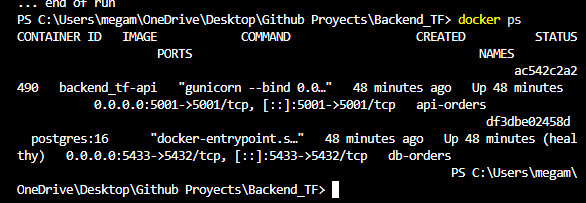

### Baja carga (10 usuarios)

**Summary Report – baja (10)**

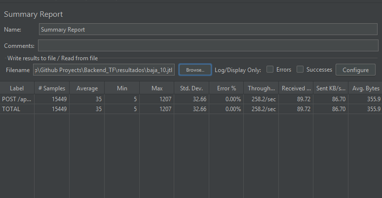

**Aggregate Report – baja (10)**

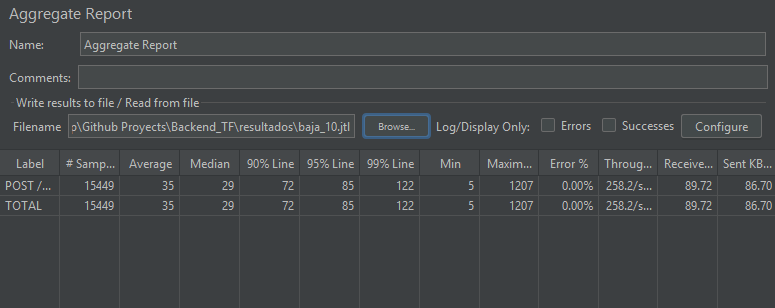

**docker stats – baja (10)**

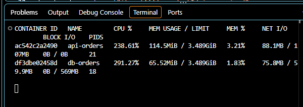

### Media carga (50 usuarios)

**Summary Report – media (50)**

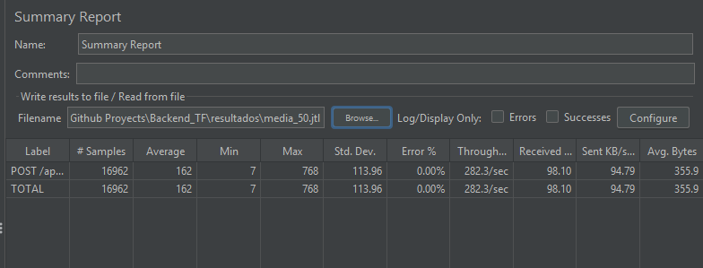

**Aggregate Report – media (50)**

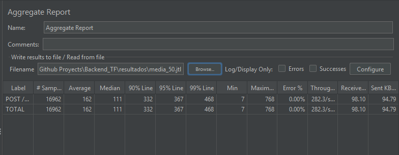

**docker stats – media (50)**

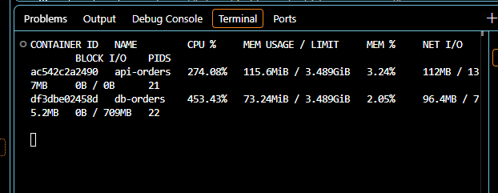

### Alta carga (100 usuarios)

**Summary Report – alta (100)**

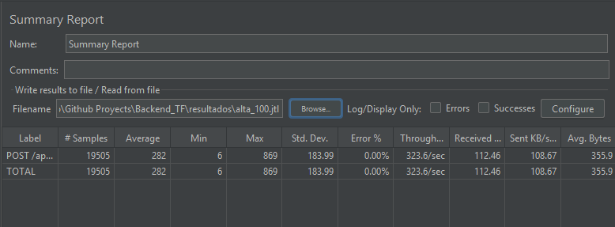

**Aggregate Report – alta (100)**

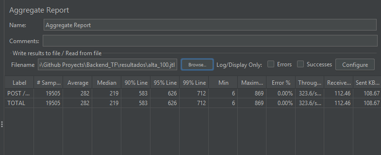

**docker stats – alta (100)**

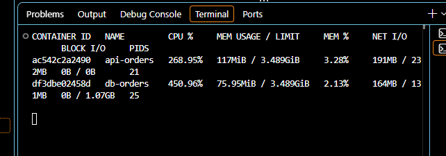

### JMeter durante la carga (100 usuarios)

**JMeter en ejecución**

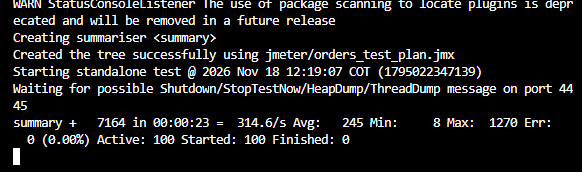

### htop durante la carga (100 usuarios)

**htop – captura 1**

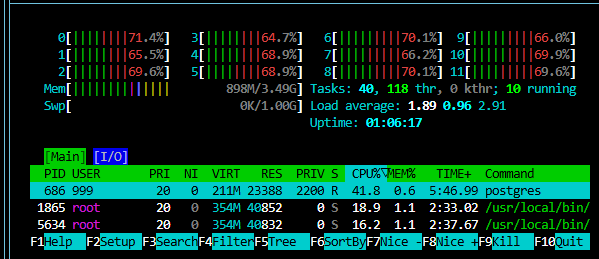

**htop – captura 2**

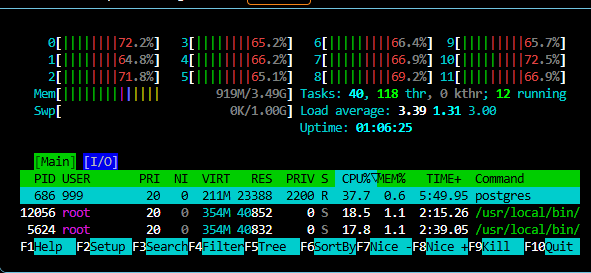

### docker stats en reposo (línea base)

**docker stats – reposo**

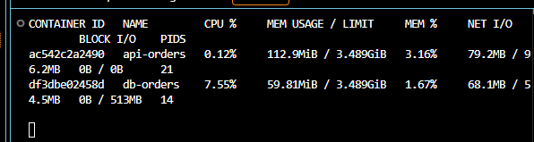

### docker stats durante el estrés (de 20 en 20)

**Estrés – 20 usuarios**

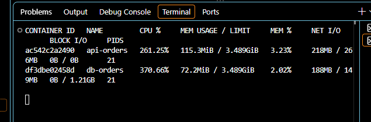

**Estrés – 40 usuarios**

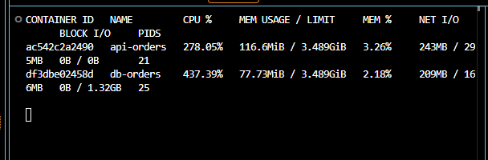

**Estrés – 60 usuarios**

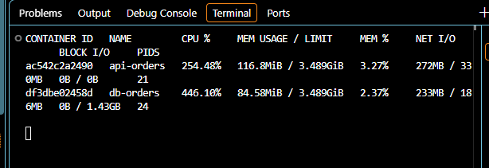

**Estrés – 80 usuarios**

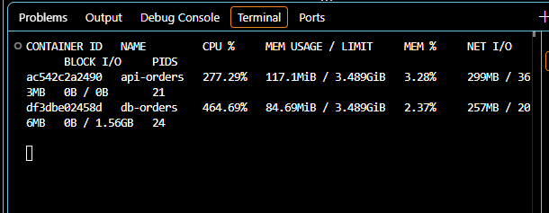

**Estrés – 100 usuarios**

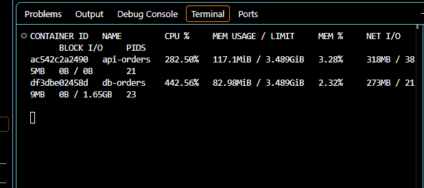

**Estrés – 120 usuarios**

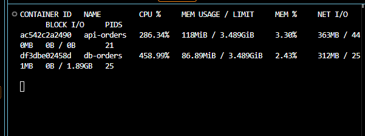

**Estrés – 140 usuarios**

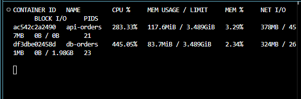

**Estrés – 160 usuarios**

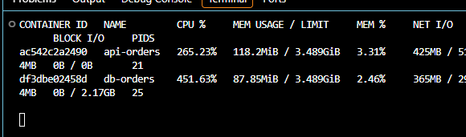

**Estrés – 180 usuarios**

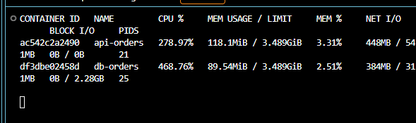

**Estrés – 200 usuarios**

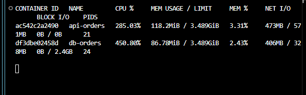
